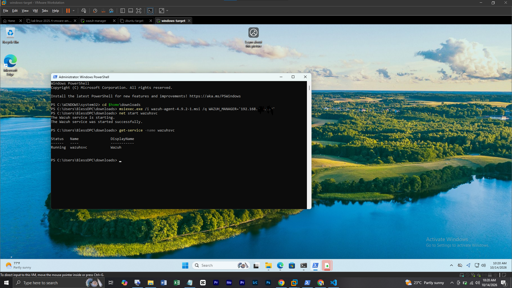
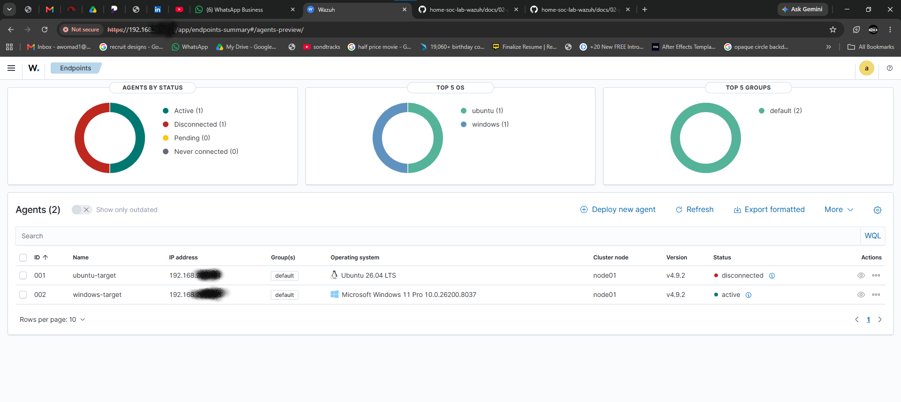

# Phase 4 — Windows Agent Setup & Connection

## What I Built

A Windows VM (`windows-target`) configured as a second monitored endpoint, running the Wazuh Agent and reporting to the Wazuh Manager. The lab now monitors a mixed Linux + Windows environment, which is how most enterprise SOCs operate.

## Why This Matters

Most real-world environments are majority Windows. Windows endpoints produce different telemetry (Windows Event Logs, registry and service activity) and are installed and managed differently from Linux. Getting both platforms reporting into one SIEM is the foundation for the attack simulations and detection rules in later phases.

## Environment

- **Host platform:** VMware Workstation
- **Guest OS:** Windows 10 (`windows-target`), 4GB RAM, 2 cores, 40GB+ disk
- **Network mode:** NAT (same network as the Wazuh Manager)
- **Agent:** Wazuh Agent 4.9.2 (`.msi`)
- **Wazuh Manager:** 192.168.xxx.xxx

## Steps Taken

1. Created the Windows VM and completed the standard Windows install with a local account
2. Checked the VM's IP with `ipconfig` and confirmed it could reach the Manager with `ping 192.168.xxx.xxx`
3. Downloaded the Wazuh Agent `.msi` installer inside the VM
4. Installed it silently from an elevated PowerShell, passing the Manager's IP at install time:
   ```powershell
   msiexec.exe /i wazuh-agent-4.9.2-1.msi /q WAZUH_MANAGER='192.168.xxx.xxx'
   ```
5. Started the agent service:
   ```powershell
   NET START WazuhSvc
   ```
6. Verified it was running:
   ```powershell
   Get-Service -Name WazuhSvc
   ```
7. Confirmed on the dashboard under **Server Management → Endpoints Summary** that both agents showed as active





- Endpoints Summary showing both agents active
- `Get-Service -Name WazuhSvc` showing `Running`

## Challenges & How I Solved Them
No active challenge was experienced

## Result

| Agent | OS | Status |
|---|---|---|
| ubuntu-target | Ubuntu Server | ✅ active |
| windows-target | Windows 10 | ✅ active |

## Next Phase

Phase 5 — Attack simulation from Kali, observing detection in Wazuh *(coming soon)*

