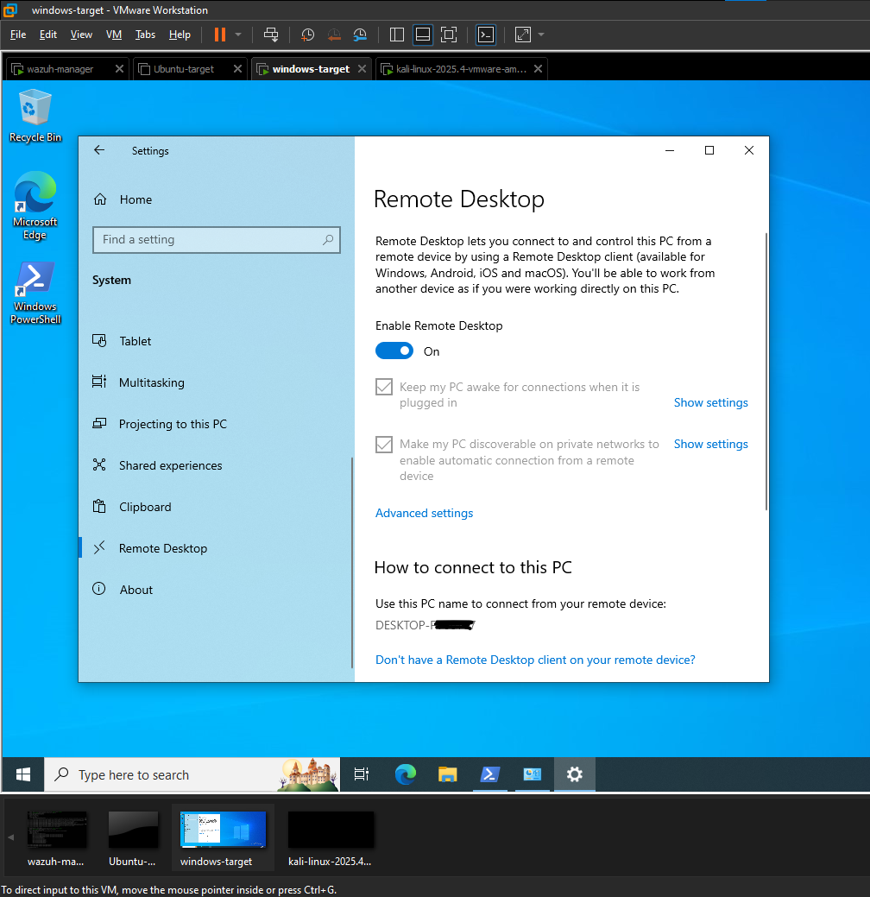
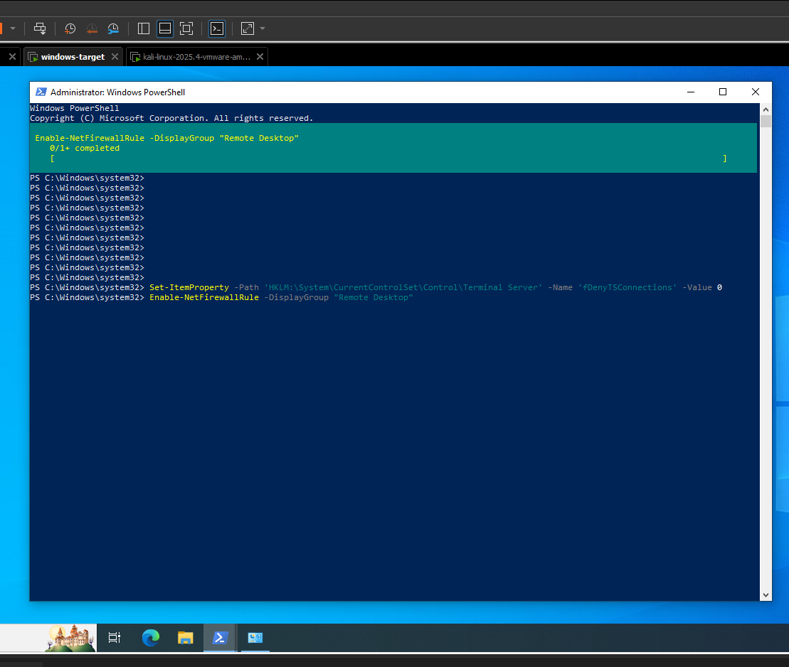
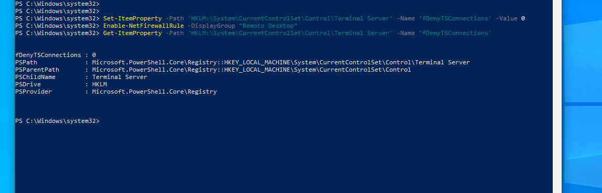
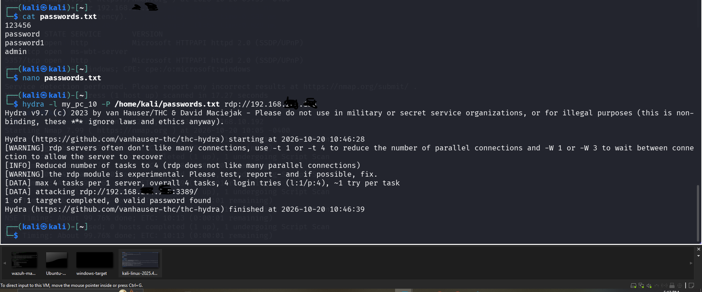
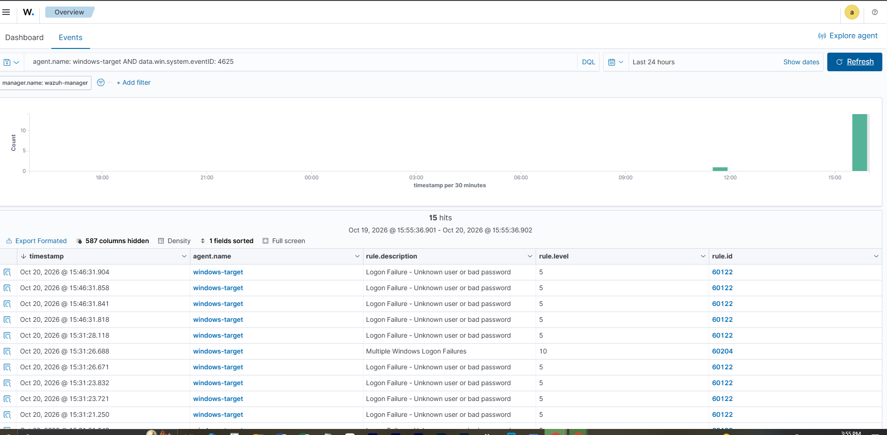

# Phase 5 — Attack Simulation & Detection Validation

## What I Did

Ran a series of controlled, known attack patterns from my Kali Linux VM against `ubuntu-target`, the monitored endpoint from Phase 3, then checked whether Wazuh saw and alerted on each one. This is the payoff phase: proving the lab doesn't just collect logs, it actually detects things.

## Why This Matters

A SIEM that silently logs everything but never alerts is no better than no SIEM at all. This phase tests the lab from the attacker's side and the defender's side at once: generate a known malicious pattern, then go find the evidence of it in Wazuh. That loop attack, then verify detection is the core of detection engineering and exactly what separates "I installed a SIEM" from "I know how to use one."

## Environment

- **Attacker:** Kali Linux VM
- **Target:** `ubuntu-target` (192.168.xxx.xxx), Wazuh agent from Phase 3
- **Manager:** `wazuh-manager` (192.168.xxx.xxx)
- **Windows target powered off for this phase** to free up lab RAM

## Pre-Checks

Before running anything, I confirmed:
- ubuntu-target VM is reachable (`ping`)


- `ubuntu-target` agent showing **active** in Endpoints Summary — an attack against a disconnected agent produces no alerts and would be a wasted test


- Wazuh Manager disk space healthy (`df -h /`) — this is what failed in Phase 3, so I check it before any phase that generates extra log volume


## Tests Run

### Test 1 — Port Scan (Reconnaissance)
```bash
nmap -sS -sV 192.168.xxx.xxx (my ubuntu-target vm)
```
**Expected finding:** a plain port scan often produces **little or no alert** from a host-based agent like Wazuh, because the agent sees host activity, not raw network probes hitting the wire. Although, nothing fired, which is a legitimate and useful finding, not a failure: it's the reason SOCs pair host agents with a network sensor like Suricata.


### Test 2 — SSH Brute-Force
Manual failed logins, then an automated burst with a short wordlist:


```bash
echo -e "password\n123456\nadmin\nletmein\nqwerty" > ~/small-list.txt
hydra -l agentadmin -P ~/small-list.txt ssh://192.168.xxx.xxx -t 4

hydra -l agentadmin -P /home/kali/passwords.txt ssh://192.168.xxx.xxx
```


**Expected finding:** repeated `sshd: authentication failed` alerts in Wazuh, escalating to `sshd: brute force trying to get access to the system` once enough failures land inside the correlation window. Checked each alert's `data.srcip` (should match Kali), `rule.id`, `rule.level`, and the MITRE ATT&CK tag (expected **T1110 — Brute Force**).


### Test 3 — Privilege Use & User Creation
On `ubuntu-target` directly:
```bash
sudo whoami
sudo useradd labtestuser
sudo userdel labtestuser
```


**Expected finding:** alerts tied to `sudo` usage and user account changes — the kind of activity a SOC watches for as a sign of privilege escalation or persistence.

## Results

Alerts actually fired


## Challenges & How I Solved Them

One of the most exhusting challenge i encountered was understanding how wazuh dashboard catches the alerts, at first i didn't understand the flow of things but carefully checking the timestamps from my kali (Attack VM) and comparing it with the timestamps on the wazuh reports i was able to understand the flow of things and how it relates to each attack from my kali.


## Now for my Windows Target — RDP Brute-Force Simulation

To confirm the lab's detection works across operating systems, not just Linux, the same style of attack was repeated against `windows-target` over RDP.

### Pre-attack troubleshooting

Two issues had to be resolved before this attack was possible, both worth noting as part of the lab's realism:

1. **Windows Firewall silently dropping ICMP** — `windows-target` would not respond to ping from Kali even though the reverse direction worked, a classic sign of Windows' default inbound-ICMP block. Resolved by adding an inbound firewall rule (`netsh advfirewall firewall add rule name="Allow ICMPv4-In" protocol=icmpv4:8,any dir=in action=allow`), restoring two-way connectivity.
2. **All 1000 scanned ports showing "filtered" on Nmap** — expected default-firewall behavior, not a fault. RDP was deliberately enabled (`Enable-NetFirewallRule -DisplayGroup "Remote Desktop"`) to create a real, intentional attack surface for this test, mirroring how a pentester would need an exposed service before any brute-force attempt is possible.









### Attack simulated

**RDP brute-force**, launched from Kali against `windows-target` using Hydra:

```bash
hydra -l my_pc_10 -P /home/kali/passwords.txt rdp://192.168.xxx.xxx
```




Result: `1 of 1 target completed, 0 valid password found` — the attack did not succeed (expected; the real password wasn't in the test wordlist), but the goal was generating failed-authentication telemetry for Wazuh to detect, not actually breaching the account.

### Detection results

Confirmed via **Threat Hunting → Events**, filtered to `agent.name: windows-target AND data.win.system.eventID: 4625`.



| Metric | Result |
|---|---|
| Total hits (24h window) | 15 |
| Individual failed-logon events | Rule 60122 — "Logon Failure - Unknown user or bad password" (level 5) |
| Correlation/escalation event | Rule 60204 — "Multiple Windows Logon Failures" (level 10) |
| Successful logons | 0 (attack did not succeed — expected) |

The same pattern seen on the Linux side held here: Wazuh didn't just log each individual failed RDP attempt (rule 60122, level 5) — it recognized the repeated-failure pattern from the same source and escalated automatically to rule 60204 at level 10, Wazuh's built-in Windows brute-force correlation rule.

### Timeline (Mean Time to Detect)

- **15:31:21 – 15:31:28** — first burst of Hydra attempts logged individually as rule 60122
- **15:31:26** — escalation event: rule 60204 fires at level 10, roughly 5 seconds after the burst of failures began
- **15:46:31** — a second Hydra run produces the same individual-failure pattern (rule 60122), confirming consistent detection across repeated test runs

**MTTD for this exercise: under 10 seconds** from first failed RDP attempt to automated severity escalation — faster than the SSH/Linux test, likely because RDP failures arrive in a tighter burst than SSH's per-attempt delay.

### What this demonstrates

- Wazuh correctly ingests and parses **Windows Event Log** data (Event ID 4625) via the agent, a fundamentally different log pipeline than the Linux syslog/PAM path used for `ubuntu-target`
- The built-in Windows brute-force correlation rule (60204) fired without any custom rule authored — confirming Wazuh's default ruleset already covers this common attack pattern out of the box
- Detection is consistent across operating systems: both the Linux SSH test and the Windows RDP test produced the same shape of result (individual failures → correlated escalation), despite completely different underlying log formats


## Key Takeaway

Detection coverage isn't uniform. Some attacks (brute-force, privilege use) are caught cleanly out of the box by Wazuh's default rules; others (a plain port scan) may need a network-layer sensor to catch at all. Knowing where the blind spots are is itself a SOC skill it's what Phase 6 (custom detection rules) will start to close.


## Next Phase

Phase 6 — Custom Detection Rules *(coming soon)*
