# Phase 5 — Attack Simulation & Detection Validation

## What I Did

Ran a series of controlled, known attack patterns from my Kali Linux VM against `ubuntu-target`, the monitored endpoint from Phase 3, then checked whether Wazuh saw and alerted on each one. This is the payoff phase: proving the lab doesn't just collect logs, it actually detects things.

## Why This Matters

A SIEM that silently logs everything but never alerts is no better than no SIEM at all. This phase tests the lab from the attacker's side and the defender's side at once: generate a known malicious pattern, then go find the evidence of it in Wazuh. That loop attack, then verify detection is the core of detection engineering and exactly what separates "I installed a SIEM" from "I know how to use one."

## Environment

- **Attacker:** Kali Linux VM
- **Target:** `ubuntu-target` (192.168.xxx.xxx), Wazuh agent from Phase 3
- **Manager:** `wazuh-manager` (192.168.xxx.xxx)
- **Windows target powered off for this phase** to free up lab RAM

## Pre-Checks

Before running anything, I confirmed:
- ubuntu-target VM is reachable (`ping`)

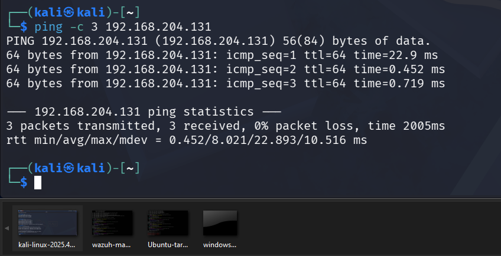


- `ubuntu-target` agent showing **active** in Endpoints Summary — an attack against a disconnected agent produces no alerts and would be a wasted test

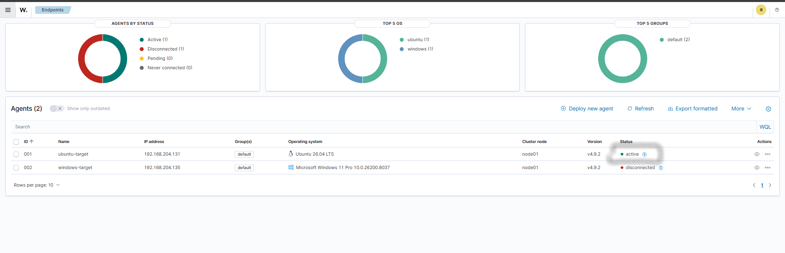


- Wazuh Manager disk space healthy (`df -h /`) — this is what failed in Phase 3, so I check it before any phase that generates extra log volume

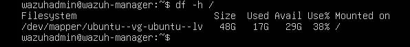


## Tests Run

### Test 1 — Port Scan (Reconnaissance)
```bash
nmap -sS -sV 192.168.xxx.xxx (my ubuntu-target vm)
```
**Expected finding:** a plain port scan often produces **little or no alert** from a host-based agent like Wazuh, because the agent sees host activity, not raw network probes hitting the wire. Although, nothing fired, which is a legitimate and useful finding, not a failure: it's the reason SOCs pair host agents with a network sensor like Suricata.

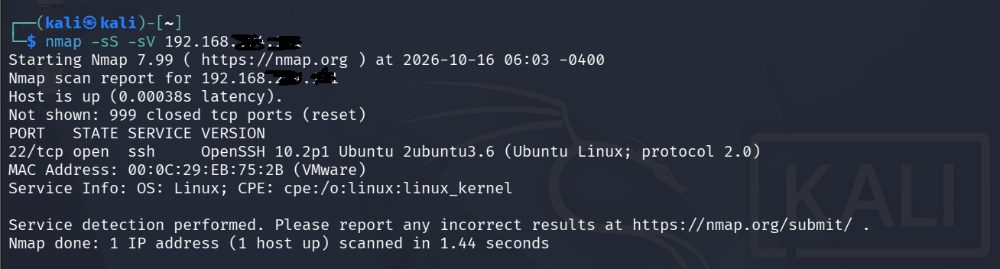


### Test 2 — SSH Brute-Force
Manual failed logins, then an automated burst with a short wordlist:
```bash
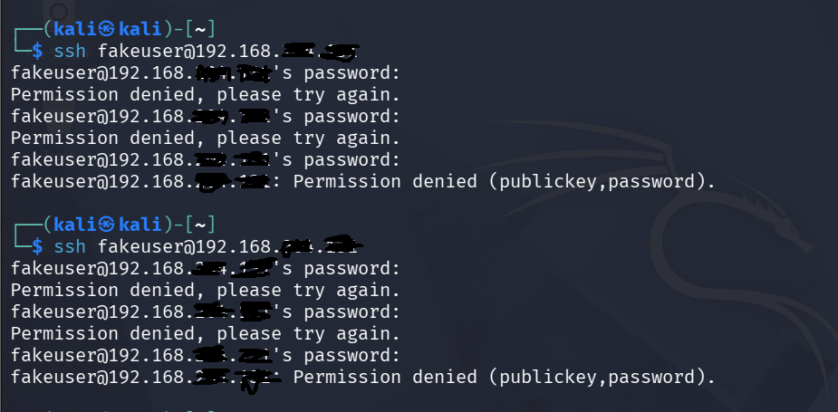

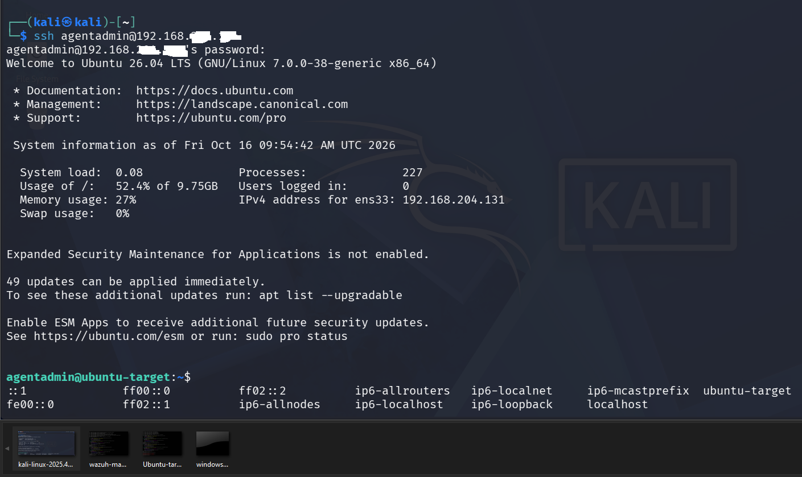

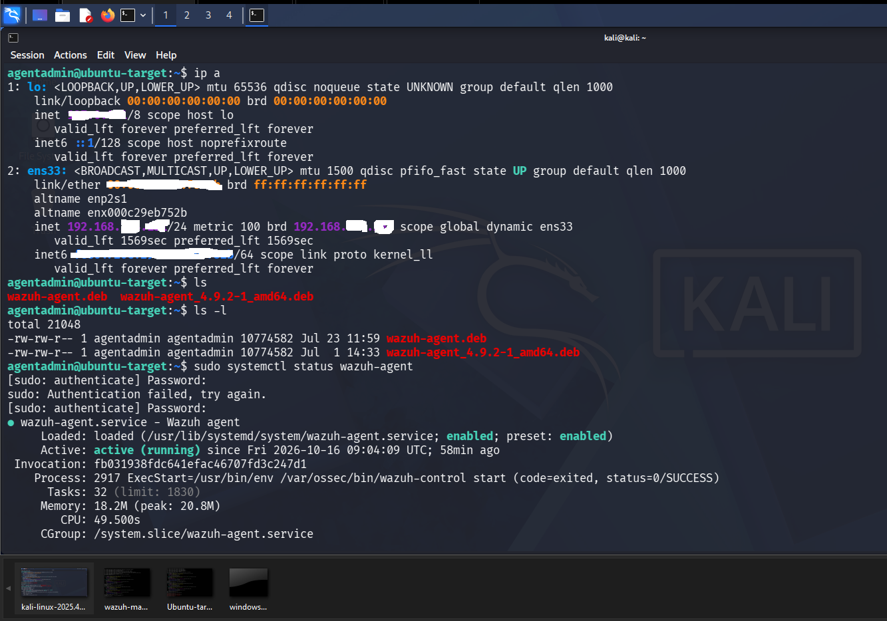

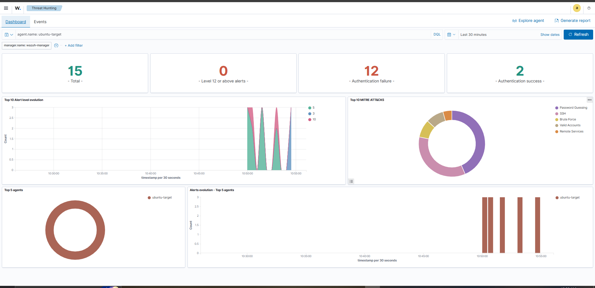


echo -e "password\n123456\nadmin\nletmein\nqwerty" > ~/small-list.txt
hydra -l agentadmin -P ~/small-list.txt ssh://192.168.xxx.xxx -t 4

hydra -l agentadmin -P /home/kali/passwords.txt ssh://192.168.xxx.xxx

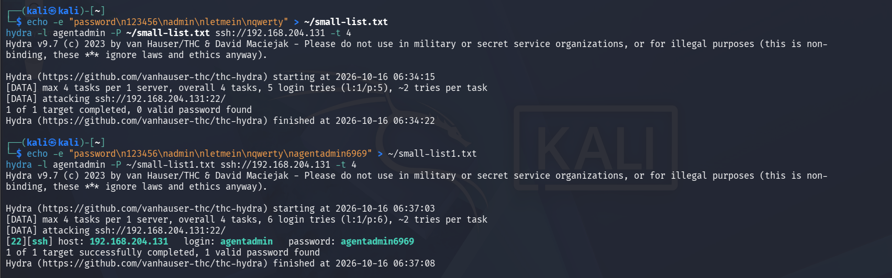

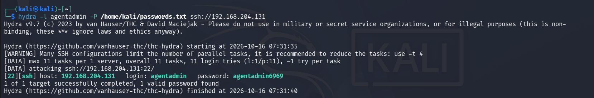


```
**Expected finding:** repeated `sshd: authentication failed` alerts in Wazuh, escalating to `sshd: brute force trying to get access to the system` once enough failures land inside the correlation window. Checked each alert's `data.srcip` (should match Kali), `rule.id`, `rule.level`, and the MITRE ATT&CK tag (expected **T1110 — Brute Force**).

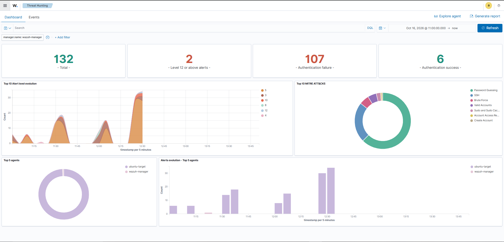


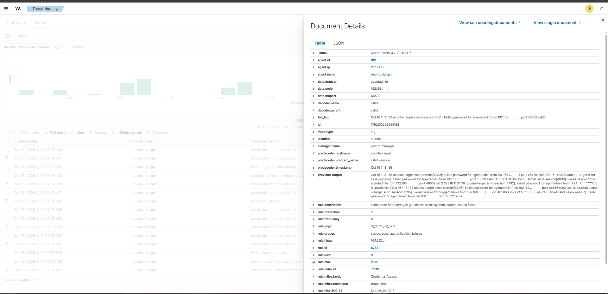


### Test 3 — Privilege Use & User Creation
On `ubuntu-target` directly:
```bash
sudo whoami
sudo useradd labtestuser
sudo userdel labtestuser
```


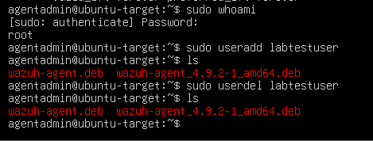

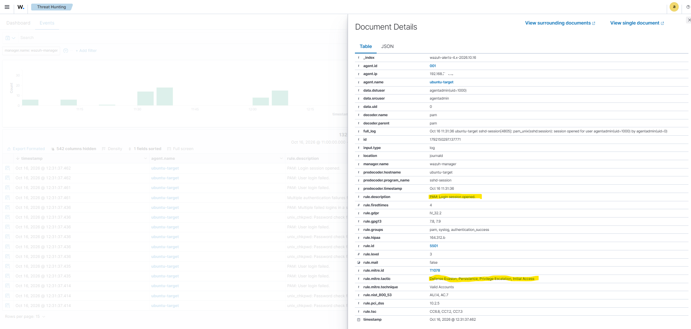


**Expected finding:** alerts tied to `sudo` usage and user account changes — the kind of activity a SOC watches for as a sign of privilege escalation or persistence.

## Results

Alerts actually fired

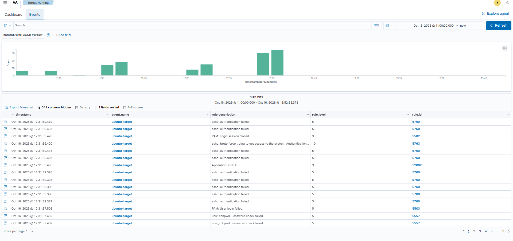


## Challenges & How I Solved Them

One of the most exhusting challenge i encountered was understanding how wazuh dashboard catches the alerts, at first i didn't understand the flow of things but carefully checking the timestamps from my kali (Attack VM) and comparing it with the timestamps on the wazuh reports i was able to understand the flow of things and how it relates to each attack from my kali.

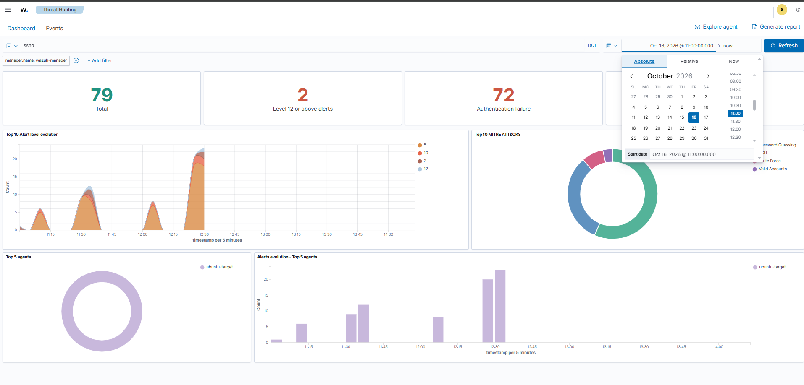

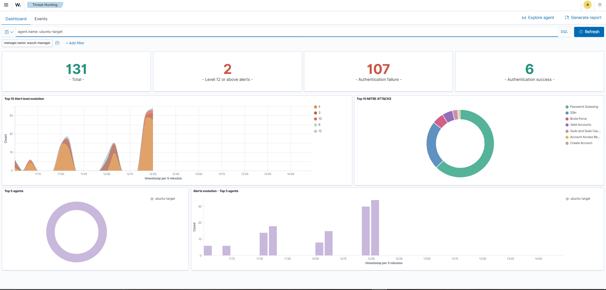


## Key Takeaway

Detection coverage isn't uniform. Some attacks (brute-force, privilege use) are caught cleanly out of the box by Wazuh's default rules; others (a plain port scan) may need a network-layer sensor to catch at all. Knowing where the blind spots are is itself a SOC skill it's what Phase 6 (custom detection rules) will start to close.


## Next Phase

Phase 6 — Custom Detection Rules *(coming soon)*
