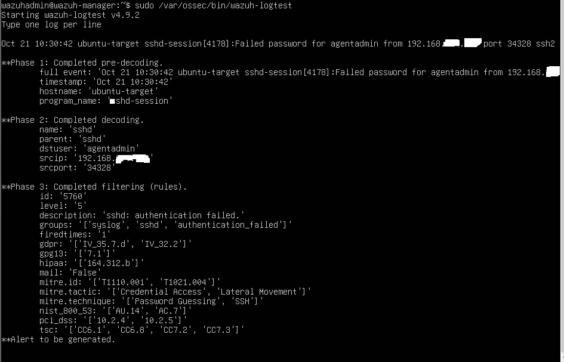
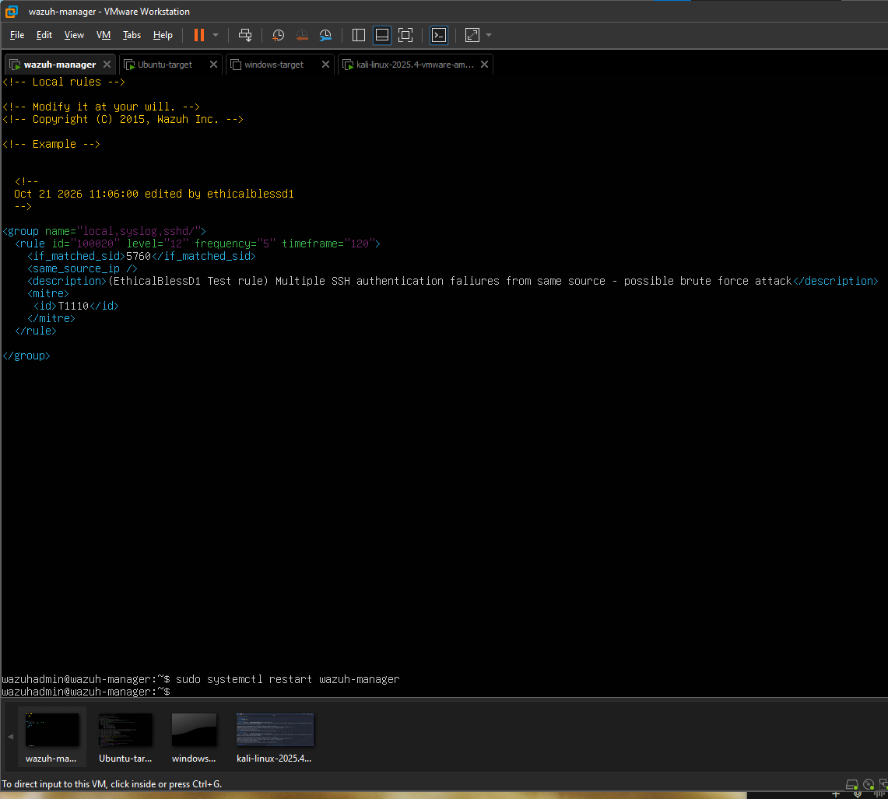
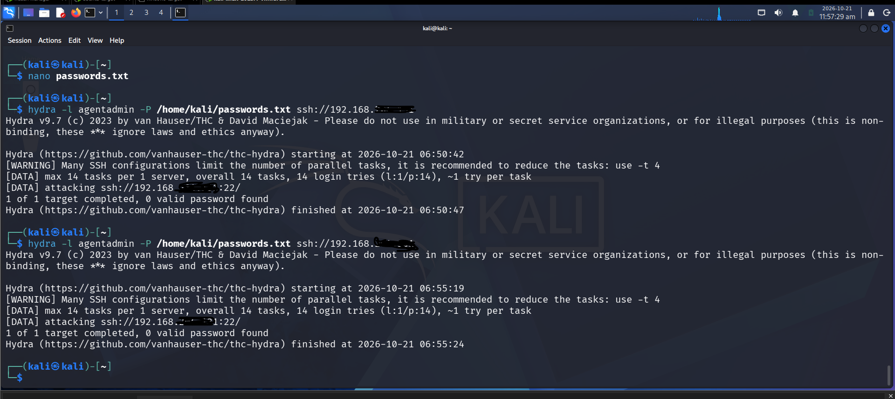
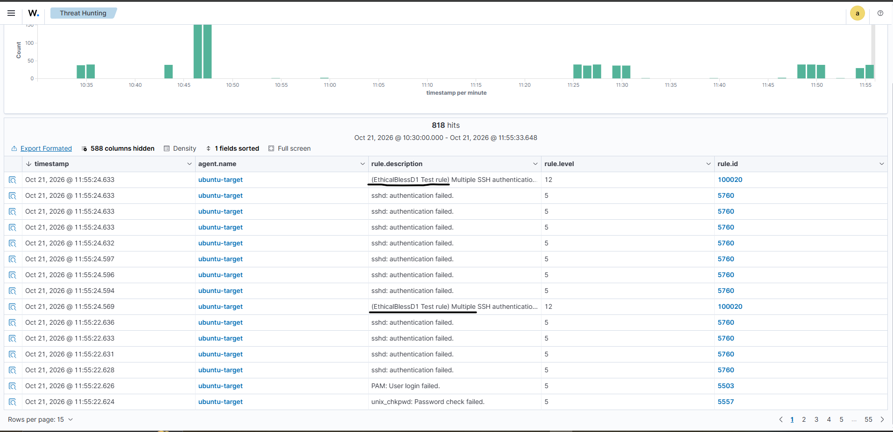
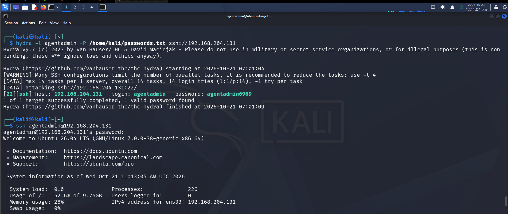
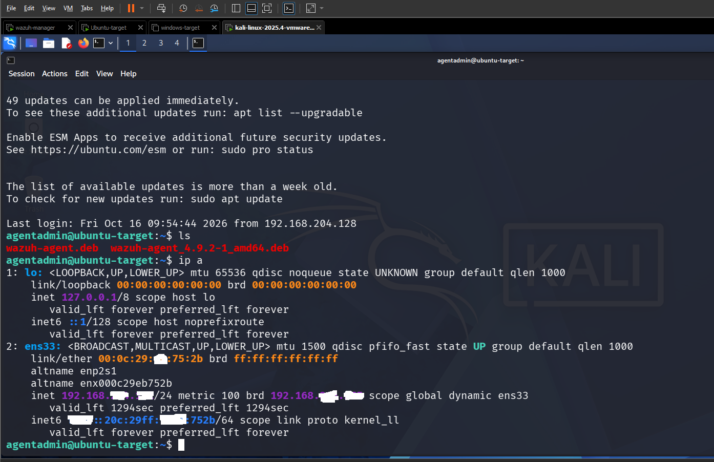
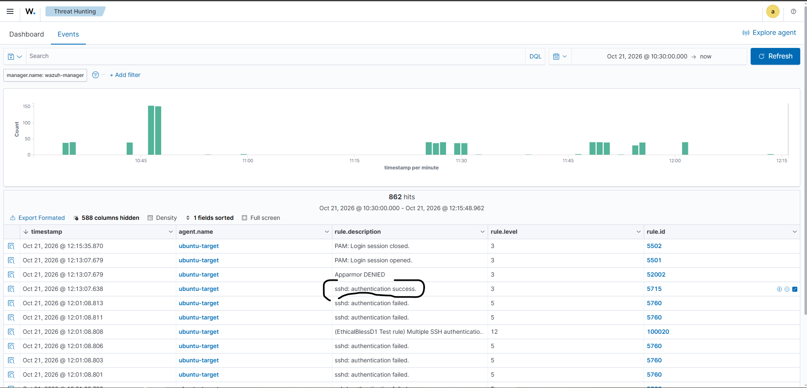
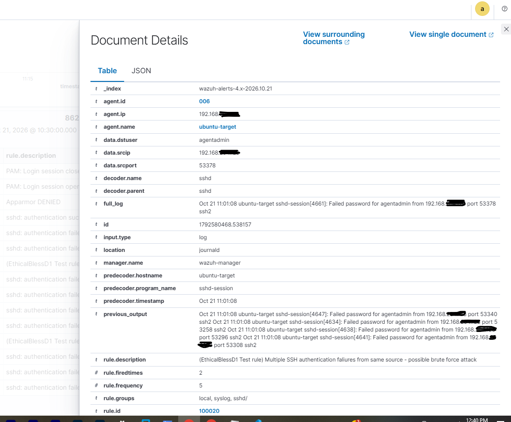

# Phase 6 — Custom Detection Rules

## What I Did

I Moved beyond Wazuh's default ruleset by writing my own correlation rule for SSH brute-force detection on `ubuntu-target`, then validated and tested it against a real attack from Kali. This is the step that separates "I installed a SIEM" from "I can tune one" — most beginner labs stop at default detections.

## Why This Matters

Default rules are a starting point, not a finished detection strategy. Every real environment has its own baseline of normal activity, and a SOC/detection engineer's job includes writing rules that fit that environment: catching the patterns default rules miss, tuning severity to match actual risk, and mapping detections to frameworks like MITRE ATT&CK so findings are consistent and explainable. Writing one custom rule end-to-end, including getting it wrong once, is a far stronger portfolio signal than screenshots of only the built-in alerts.

## Environment

- **Wazuh Manager:** 192.168.xxx.xxx, local rules file at `/var/ossec/etc/rules/local_rules.xml`
- **Target:** `ubuntu-target` (192.168.xxx.xxx)
- **Attacker:** Kali Linux VM, `hydra`

## Steps Taken

1. **Identified the base rule to build on.** Checked the alerts from the Phase 5 Hydra run and found the actual rule firing on failed SSH logins was **rule `5760`** ("sshd: authentication failed").


2. **Opened the local rules file** on the Wazuh Manager:
   ```bash
   sudo nano /var/ossec/etc/rules/local_rules.xml
   ```
   This file is empty by default and reserved for custom rules, so manager updates never overwrite it.


3. **Wrote a custom correlation rule** that escalates severity when 5+ SSH failures arrive from the same source IP within 120 seconds:
   ```xml
   <group name="local,syslog,sshd,">
     <rule id="100020" level="12" frequency="5" timeframe="120">
       <if_matched_sid>5760</if_matched_sid>
       <same_source_ip />
       <description>(EthicalBlessD1 Test rule) Multiple SSH authentication failures from same source - possible brute force attack</description>
       <mitre>
         <id>T1110</id>
       </mitre>
     </rule>
   </group>
   ```
   Used the `100000+` ID range reserved for local/custom rules to avoid colliding with Wazuh's built-in ruleset.


4. **Validated the rule's syntax before touching the live manager:**
   ```bash
   sudo /var/ossec/bin/wazuh-logtest
   ```



5. **Restarted the manager** to load the rule:
   ```bash
   sudo systemctl restart wazuh-manager
   ```



6. **Re-ran the Hydra attack** from Kali and checked the dashboard, searching `rule.id: 100020`, to confirm the custom rule fired on top of the default detections.












## Challenges & How I Solved Them

- **Custom rule referenced the wrong base rule ID.** I originally wrote `100020` against `if_matched_sid 5763`, assuming that was the rule firing on SSH failures. Running `wazuh-logtest` against a real sample log line showed the actual match was **`5760`**, not `5763`. I corrected `if_matched_sid` to `5760` and re-tested, rather than restarting the manager on an untested assumption. This is exactly why the validation step exists: a rule built against the wrong base ID silently never fires, and without `wazuh-logtest` that failure mode is invisible until you've already wasted a full attack-and-check cycle.
- **The default rule I built on top of was already more specific than I expected.** Rule `5760` carries its own MITRE tags — **T1110.001** (Password Guessing) and **T1021.004** (Lateral Movement via SSH) — which are sub-techniques more granular than the plain `T1110` my custom rule adds. Worth noting for anyone reading this: Wazuh's default ruleset is often already MITRE-mapped at a fine-grained level, so a custom rule's real value is usually in the correlation logic (frequency, timeframe, same-source-IP) rather than in adding a MITRE tag that may already exist upstream.
- **The brute-force actually succeeded.** Hydra recovered a real, weak credential on `ubuntu-target` during testing. Rather than treat that as a side effect, I logged in deliberately to complete the attack chain and confirmed rule **`40112`** ("Multiple authentication failures followed by a success") fired for real — not as a theoretical scenario, but because the compromise genuinely happened. I then rotated the password immediately. This turned the phase into a full chain: recon → brute-force → successful compromise → detection, which is a stronger result than most beginner labs produce.

## Result



| Rule | Type | Trigger | Level | MITRE |
|---|---|---|---|---|
| `5760` | Default | Single SSH auth failure | 5 | T1110.001, T1021.004 |
| `100020` | **Custom** | 5+ failures, same source IP, within 120s | 12 | T1110 |
| `40112` | Default correlation | Failures followed by a successful login | 12 | T1078 + T1110 |

## Remediation Recommendation

The successful brute-force exposed a weak password policy on `ubuntu-target`. In a real environment this would warrant:
- Enforcing password complexity requirements
- Adding login-attempt lockout (e.g. `fail2ban` or Wazuh's active response)
- Disabling direct password authentication over SSH in favor of key-based auth where possible

## All Phases now complete

